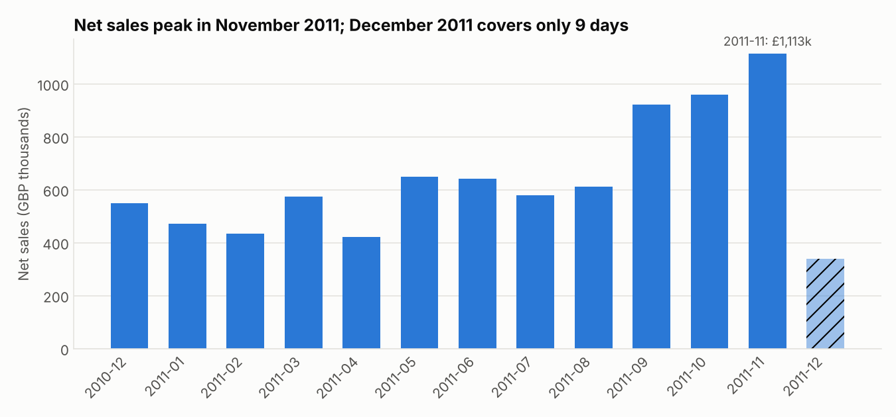
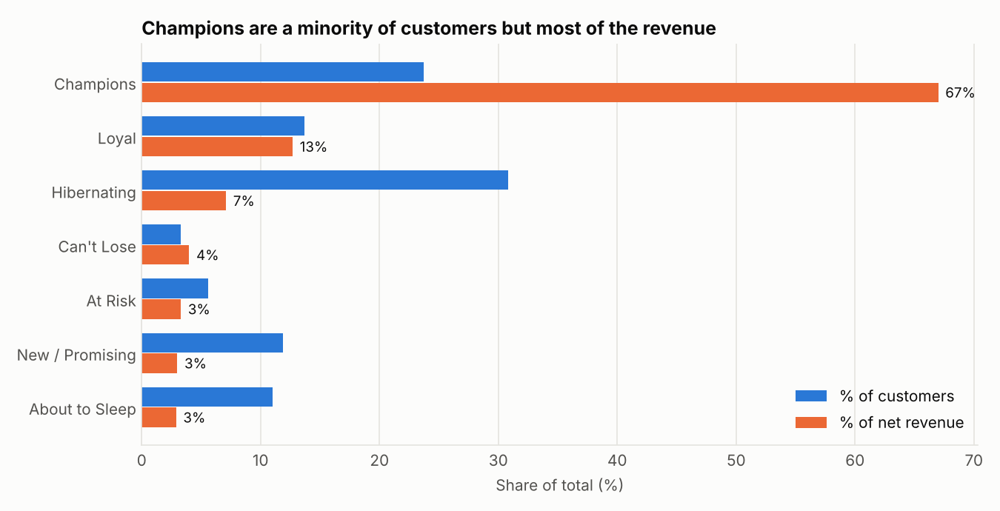
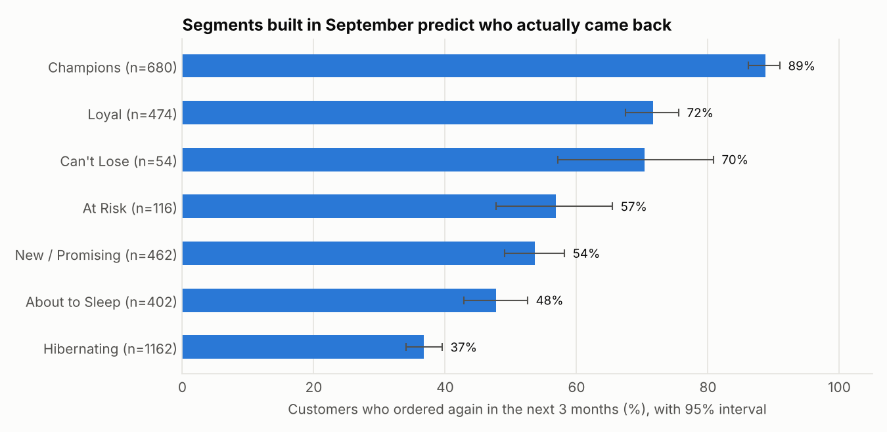

# Retail Customer Segmentation (RFM) for a Retention Campaign

Which customers should a UK online retailer spend its retention budget on? I segmented 4,318 customers with RFM scoring and then tested on a 3-month holdout whether the segments really predict who comes back.

## Business problem

A marketing manager has a limited retention budget and wants to know three things:

1. Who are the customers that generate most of the revenue?
2. Which customers are drifting away?
3. Is it worth spending on customers who have gone quiet, and if so, how much?

## Data

- **Source:** [UCI Machine Learning Repository, Online Retail dataset](https://archive.ics.uci.edu/dataset/352/online+retail) (Daqing Chen). Real transaction data from a UK-based online gift retailer. **This is not simulated data.**
- **License:** CC BY 4.0
- **Size:** 541,909 rows, one row per invoice line, 2010-12-01 to 2011-12-09
- **Columns:** InvoiceNo, StockCode, Description, Quantity, InvoiceDate, UnitPrice, CustomerID, Country
- The raw file is included at `data/raw/online_retail.xlsx` (about 24 MB).

## Approach

**1. Cleaning** (`src/01_clean.py`, every step is logged in `reports/cleaning_log.csv`)

| Step | Rows removed | Rows left |
|---|---|---|
| Raw data | | 541,909 |
| Bad-debt accounting adjustments (invoices starting "A") | 3 | 541,906 |
| Cancellations / returns (invoices starting "C"), moved to a separate returns file | 9,288 | 532,618 |
| No CustomerID (cannot be assigned to a customer) | 134,694 | 397,924 |
| Exact duplicate rows | 5,192 | 392,732 |
| Quantity or UnitPrice of 0 or less | 40 | 392,692 |
| Non-product codes (postage, fees, discounts, manual entries) | 1,542 | 391,150 |

The clean data covers 4,334 customers and 18,402 invoices.

**2. RFM scoring** (`src/03_rfm_segmentation.py`). "Today" is 2011-12-10, the day after the last transaction.

- **Recency:** days since the last purchase. **Frequency:** number of distinct invoices. **Monetary:** net spend, meaning sales minus returns.
- Recency and Monetary are scored 1 to 5 by quintile. Frequency uses fixed bins (1, 2, 3, 4-5, 6+ invoices) because 35% of customers bought exactly once, and quintiles would split identical customers into different scores.
- Monetary is net of returns because two customers (16446 and 12346) each bought and then fully cancelled a single order worth £168k and £77k. On gross spend they would look like top customers. Customers who returned 95% or more of what they bought are excluded (16 customers), leaving 4,318 scored customers.

| Segment | Rule |
|---|---|
| Champions | R 4-5 and F 4-5 |
| Loyal | R 3-5 and F 3-5, not Champions |
| New / Promising | R 4-5 and F 1-2 |
| About to Sleep | R 3 and F 1-2 |
| Can't Lose | R 1-2, F 4-5 and M 4-5 |
| At Risk | R 1-2 and F 3-5, not Can't Lose |
| Hibernating | R 1-2 and F 1-2 |

**3. Holdout validation** (`src/04_holdout_validation.py`). I pretended today was 2011-09-09, scored 3,350 customers using only data before that date, and checked who ordered again between 2011-09-09 and 2011-12-09.

## Key findings



Net sales total £8.26M. November 2011 is the peak month at £1.11M, and the Sep-Nov ramp matters for the holdout (see limitations).

**1. Revenue is concentrated.** Champions are 23.7% of customers but 67.0% of net revenue (£5.54M). The top 20% of customers by spend produce 73.8% of net revenue. Only 65.3% of customers ever ordered a second time, and the median customer placed 2 orders.



**2. The segments predict who comes back.** Of customers scored in September, 88.8% of Champions ordered again in the next three months, against 36.8% of Hibernating customers (overall: 57.2%).



| Segment | Customers (Dec snapshot) | % of customers | % of net revenue | Ordered again in next 3 months (95% interval) |
|---|---|---|---|---|
| Champions | 1,023 | 23.7% | 67.0% | 88.8% (86.2-91.0) |
| Loyal | 591 | 13.7% | 12.7% | 71.7% (67.5-75.6) |
| New / Promising | 515 | 11.9% | 3.0% | 53.7% (49.1-58.2) |
| About to Sleep | 474 | 11.0% | 2.9% | 47.8% (42.9-52.6) |
| At Risk | 242 | 5.6% | 3.3% | 56.9% (47.8-65.5) |
| Can't Lose | 142 | 3.3% | 4.0% | 70.4% (57.2-80.9) |
| Hibernating | 1,331 | 30.8% | 7.1% | 36.8% (34.1-39.6) |

The repurchase column comes from the September holdout (3,350 customers), so segment sizes there differ from the December snapshot.

**3. Dormant customers are not dead.** Hibernating customers (last purchase about 208 days ago on average) are 30.8% of the base and 7.1% of revenue, yet 36.8% of them ordered again and they produced 9.8% of all spend in the following three months (£251k).

**4. The middle segments are not distinguishable.** The confidence intervals for At Risk (47.8-65.5%), New / Promising (49.1-58.2%) and About to Sleep (42.9-52.6%) overlap. The data does not support treating them as three different groups.

**5. "Can't Lose" is small but valuable.** These 142 customers averaged £2,326 net spend over the year, and in the holdout 38 of 54 (70.4%) came back. The remaining 16 are where a personal call could matter.

## Recommendations

- **Champions:** do not discount. 88.8% return anyway and they generated 62.1% of spend in the holdout window. Use early access and service perks instead.
- **Can't Lose:** personal outreach (an account-manager email or call), because the spend per customer is high and the group is small enough to contact individually.
- **Loyal:** nudge towards Champion status with a reward for reaching their next order milestone. 71.7% return, so they are already warm.
- **New / Promising:** a second-order campaign in the weeks after a first purchase. Only 53.7% ordered again.
- **At Risk and About to Sleep (716 customers together):** one low-cost reminder campaign, since the data shows no reliable difference between them.
- **Hibernating:** email-only win-back. Keep spend per head low: 36.8% still ordered, but each averaged only £216 in the next three months.

## Limitations and next steps

- **Seasonality.** The holdout window (Sep-Dec) is the retailer's peak season, so repurchase rates are higher than they would be in a quiet quarter. With only one year of data I cannot separate seasonal buying patterns from real churn.
- **Customers without an ID.** 134,694 purchase lines (about a quarter of the sales rows) had no CustomerID and are excluded, so results apply only to identified customers.
- **Judgment calls.** The frequency bins and the segment rules are my choices and were not tuned. A different rule set would shift the segment sizes.
- **Correlation, not a campaign result.** The holdout shows which segments come back on their own. It does not show that a campaign would raise those rates. An A/B test with a held-out control group would answer that.
- **Next steps:** repeat the holdout at several cutoff dates, and add product-category behaviour to the segments.

## How to run

Tested with Python 3.13, pandas 3.0, numpy 2.5, matplotlib 3.11 and openpyxl 3.1.

```bash
pip install -r requirements.txt
bash run_all.sh        # about 1 minute; or run the four scripts in src/ in order
```

Outputs: `data/processed/` (cleaned data, customer scores), `reports/` (summary tables and `key_metrics.json`), `images/` (charts).

## Repository layout

```
├── README.md
├── requirements.txt
├── run_all.sh
├── data/
│   ├── raw/online_retail.xlsx        original UCI file, untouched
│   └── processed/                    created by the scripts
├── src/
│   ├── utils.py                      paths and shared helpers
│   ├── plotstyle.py                  chart styling
│   ├── rfm.py                        RFM scoring and segment rules
│   ├── 01_clean.py
│   ├── 02_eda.py
│   ├── 03_rfm_segmentation.py
│   └── 04_holdout_validation.py
├── reports/                          tables and key_metrics.json
└── images/                           charts used above
```

## Notes

Built with AI assistance (Claude). The code was reviewed by the author.
